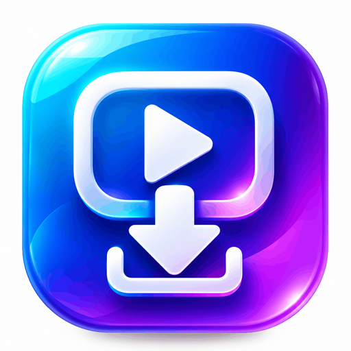

<div align="center">



# Video Saver

**A free, open source Android video downloader for YouTube, Instagram, Facebook and TikTok.**

Paste a link, tap Download, and the video is saved to your phone as a standard MP4 file.

[](LICENSE)
[](#requirements)
[](https://kotlinlang.org)
[](CHANGELOG.md)
[](#privacy)
[](#privacy)

[Download the APK](../../releases) | [Documentation](docs/) | [Troubleshooting](docs/TROUBLESHOOTING.md) | [Build from source](docs/BUILDING.md)

</div>

---

## What is Video Saver?

Video Saver is an Android app that downloads videos from social media and video sites and saves
them on your own device. It runs the open source download engine yt-dlp inside the app, so no
server is involved, no account is needed, and no data leaves your phone.

The app is written in Kotlin with Material 3, works offline after the first engine setup, and
stores every file in the public `Download/VideoSaver` folder where your gallery and file manager
can find it.

## Supported sites

| Site | Link types supported | Notes |
|---|---|---|
| **YouTube** | `youtube.com/watch?v=`, `youtu.be/`, `m.youtube.com`, Shorts, `youtube.com/live/` | Some videos need sign in cookies from the site |
| **Instagram** | `instagram.com/p/`, `/reel/`, `/tv/`, `/share/` | Private accounts are not accessible |
| **Facebook** | `facebook.com/watch`, `fb.watch`, `/videos/`, `/reel/`, `/share/v/` | Public videos only |
| **TikTok** | `tiktok.com/@user/video/`, `m.tiktok.com`, `vm.tiktok.com`, `vt.tiktok.com`, `tiktok.com/t/`, `tiktokv.com` | Photo and slideshow posts have no video stream |

The app detects the platform from the link and shows it as a badge before the download starts.
Because the engine is yt-dlp, most other sites that yt-dlp supports also work with a pasted link.

## Features

- **One tap download.** Paste a link from any app, tap Download, done.
- **H.264 MP4 output.** Every download prefers H.264 video in an MP4 container, so the file plays
  everywhere and can be re uploaded to TikTok, Instagram or WhatsApp without a decoding error.
- **Two downloads at once.** A fixed thread pool runs two jobs in parallel and queues the rest.
- **Progress that survives.** A foreground service keeps the download alive with a progress
  notification when you switch apps or lock the screen.
- **Saved files list.** Open, share or delete each download from inside the app.
- **Self updating engine.** Sites change often, so the app can update yt-dlp from the header action
  instead of waiting for a new APK release.
- **Small and honest.** No ads, no analytics, no network calls except the download itself.
- **Unit tested.** 38 tests cover link parsing, format choice, file naming and error messages.

## Screenshots

<div align="center">

| Main screen | Download in progress | Saved files |
|---|---|---|
| Paste a link, see the platform badge | Live percentage and cancel | Open, share, delete |

</div>

Screenshots are added with each release. See the [latest release](../../releases/latest).

## Install

### Option 1: Install the APK

The app bundles a Python runtime and ffmpeg, which are large, so the build is split per CPU
architecture. Download the one that matches your phone:

| File | Size | Use it for |
| --- | --- | --- |
| [app-arm64-v8a.apk](https://github.com/Cortex-AI-IDE/VS_downloader/releases/latest/download/app-arm64-v8a.apk) | 59 MB | Almost every phone released since 2017. Start here. |
| [app-armeabi-v7a.apk](https://github.com/Cortex-AI-IDE/VS_downloader/releases/latest/download/app-armeabi-v7a.apk) | 52 MB | Older 32-bit phones |
| [app-x86_64.apk](https://github.com/Cortex-AI-IDE/VS_downloader/releases/latest/download/app-x86_64.apk) | 62 MB | Android emulators |
| [app-universal.apk](https://github.com/Cortex-AI-IDE/VS_downloader/releases/latest/download/app-universal.apk) | 151 MB | Fallback if you are unsure which one you need |

If you do not know your architecture, pick `arm64-v8a`. Every release also ships a
`SHA256SUMS.txt` so you can verify the download.

1. Download the file on your phone. Android will ask to allow installs from your browser or
   file manager. Allow it once for that app.
2. Google Play Protect may warn that the app is unknown because it is signed with a debug key,
   not a Play Store key. Tap **More details**, then **Install anyway**. This is expected for any
   sideloaded build.
3. Launch Video Saver and wait for the engine to unpack on the first run.

The app is distributed as a direct APK and is not on Google Play. Google Play policy does not
allow apps that download media from other platforms.

### Option 2: Build from source

Full instructions are in [docs/BUILDING.md](docs/BUILDING.md). The short version:

```bash
git clone https://github.com/Cortex-AI-IDE/VS_downloader.git
cd VS_downloader
echo "sdk.dir=/path/to/android-sdk" > local.properties
./gradlew assembleDebug
adb install -r app/build/outputs/apk/debug/app-arm64-v8a-debug.apk
```

## Requirements

- Android 7.0 (API 24) or newer
- About 150 MB of free storage for the APK plus the unpacked engine
- A network connection for the download itself

## How it works

| Layer | Choice |
|---|---|
| Language | Kotlin, single Activity, View Binding, Material 3 dark theme |
| Download engine | yt-dlp 2026.10.26 with a bundled Python runtime |
| Engine wrapper | `io.github.junkfood02.youtubedl-android` 0.18.1 with the ffmpeg module |
| Concurrency | Two downloads at a time on a fixed thread pool |
| Storage | MediaStore into `Download/VideoSaver` on Android 10+, direct file copy before that |
| Background work | Foreground service with a progress notification |

```
app/src/main/java/com/hakeem/videosaver/
  VideoSaverApp.kt        Application, warms up the engine on startup
  EngineManager.kt        Initializes and updates yt-dlp plus ffmpeg
  DownloadCenter.kt       Runs downloads, parses progress, saves results
  DownloadsRepository.kt  MediaStore listing, open, share, delete
  DownloadService.kt      Foreground service with progress notification
  MainActivity.kt         Paste field, progress card, saved file list
  DownloadAdapter.kt      List of saved files
  UrlHelper.kt            Link validation and platform detection
  FormatPolicy.kt         Format choice, keeps output as H.264 MP4
  FileNamePolicy.kt       Keeps file names inside the filesystem limit
  ErrorText.kt            Turns engine output into a readable error
  YtDlpVersion.kt         Reads and compares engine versions
```

Electron was considered and rejected because it only targets desktop platforms. The full stack
research is in [docs/research.md](docs/research.md).

## Frequently asked questions

### Is Video Saver free?

Yes. It is free and open source under the GNU GPL v3. There are no ads, no subscriptions and no
paid features.

### Does it work without an account?

Yes. No sign in is required. The app never asks for your social media password.

### Where are the videos saved?

In the public `Download/VideoSaver` folder on internal storage. Gallery apps and file managers can
open that folder directly.

### Why does TikTok say "couldn't decode, select another video" when I upload?

That message appears when the file is not a standard H.264 MP4. Older versions of this app fell
back to WebM, MKV or AV1 files, which the TikTok uploader cannot read. Version 1.2.0 and newer
always prefer H.264 video inside an MP4 container. Delete the old file, update the app, and
download again. See [Troubleshooting](docs/TROUBLESHOOTING.md).

### Why do I see a message that the engine is out of date?

yt-dlp is updated frequently because the websites change. When the bundled engine is more than
about three months old, yt-dlp prints a warning. Use the **Update engine** action in the header,
or install the latest APK which ships a current engine.

### Can I download private or age restricted videos?

Not without cookies from a signed in browser session, and this app does not import browser
cookies. Public videos work normally.

### Does it download audio only?

Not yet. Audio extraction is on the roadmap. The ffmpeg module is already bundled, so this is a
small addition.

### Is it on F-Droid or Google Play?

Not yet. F-Droid is being prepared. Google Play does not accept apps of this type.

### Which Android versions are supported?

Android 7.0 and newer. The app targets Android 15 (API 35) and complies with scoped storage.

### Does the app collect any data?

No. There is no analytics, no crash reporting and no advertising library. The only network
traffic is the video download you request.

## Privacy

Video Saver has no telemetry. It does not read your contacts, location, camera or microphone. It
requests network access, notification permission for the progress bar, and storage access for the
saved files list. Your links and files stay on your device.

## Troubleshooting

Common problems and fixes are documented in [docs/TROUBLESHOOTING.md](docs/TROUBLESHOOTING.md),
including:

- "couldn't decode, select another video" on upload
- engine out of date warnings
- "File name too long" errors
- Instagram links that fail with a broken profile error
- downloads that stop when the screen turns off

## Roadmap

- [ ] Audio only downloads (MP3, M4A)
- [ ] Download history with retry
- [ ] Playlist and channel support
- [ ] Optional cookie import for restricted videos
- [ ] F-Droid listing
- [ ] Localisation, starting with Malayalam

## Contributing

Contributions are welcome. Read [CONTRIBUTING.md](CONTRIBUTING.md) first, then open an issue or a
pull request. Please follow the [Code of Conduct](CODE_OF_CONDUCT.md).

Good first issues are labelled in the issue tracker.

## Security

To report a vulnerability, follow [SECURITY.md](SECURITY.md). Please do not open a public issue for
security problems.

## License

Video Saver is released under the [GNU General Public License v3.0](LICENSE).

This license is required because the app links the `youtubedl-android` library, which is also
GPL-3.0. Third party components and their licenses are listed in [NOTICE](NOTICE).

## Disclaimer

Downloading media may conflict with the terms of service of the source website and with
copyright law. Use Video Saver only for content you own or have permission to save, and follow
the rules that apply in your country.

<div align="center">

Made with Kotlin, yt-dlp and no advertisements.

</div>
